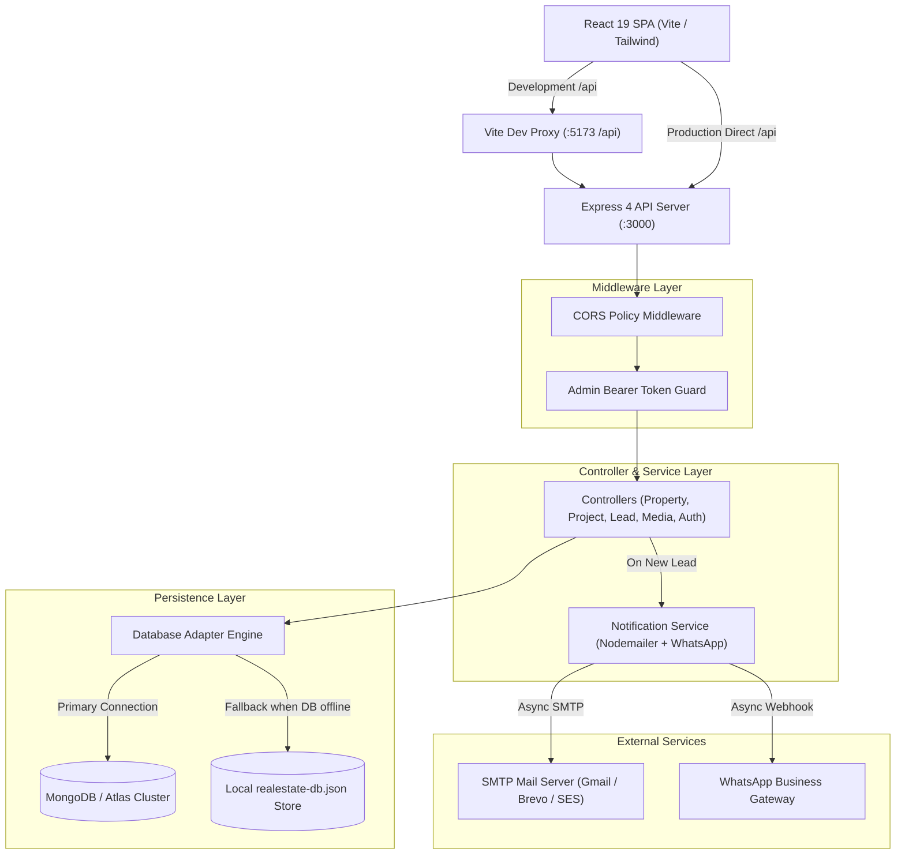
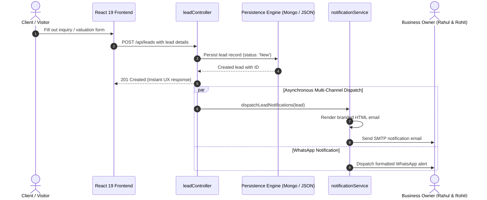

# System Architecture & Technical Specifications

## 1. Architectural Philosophy

Trinetra Realty is designed with the following core engineering principles:
1. **Decoupled Domain Layer**: Core real estate data contracts live in `shared/types/` rather than within framework-specific UI or database modules.
2. **Dual-Persistence Engine**: Transparent failover between enterprise MongoDB (via Mongoose v9) and zero-dependency local JSON file storage (`backend/data/realestate-db.json`), guaranteeing 100% platform availability across varied hosting environments.
3. **Layered Express API**: Strict separation between configuration, routing, controller orchestration, data modeling, and third-party notification services.
4. **Resilient Lead Processing**: Guaranteed lead intake with non-blocking, asynchronous dual-channel notification dispatch (SMTP email and WhatsApp).

---

## 2. High-Level Architecture Diagram

---

## 3. Lead Ingestion & Notification Workflow

When a visitor requests a property valuation, submits a general enquiry, or schedules a site visit:

---

## 4. Dual-Persistence Mechanism

The platform features an intelligent persistence layer (`backend/services/database.ts`):

1. **MongoDB Mode (Primary)**:
   - When `MONGODB_URI` is provided, Mongoose initializes a connection pool with modern settings (`family: 4` to bypass Windows IPv6 DNS latency).
   - All Mongoose models (`Property`, `Project`, `Lead`, `Locality`, `BlogPost`, `Media`, `AdminSession`, `WhatsAppSession`) operate with schema-level validation, default indexes, and virtual projections.
2. **Local JSON Mode (Fallback / Self-Contained)**:
   - If MongoDB is unreachable, the database service gracefully falls back to `backend/data/realestate-db.json`.
   - Data mutations write synchronously via atomic filesystem writes, ensuring that local development and offline environments function with zero external infrastructure.

---

## 5. Security & Authentication Model

- **Session Architecture**: Custom bearer token authentication with an 8-hour sliding window.
- **Credential Storage**: Admin credentials are read strictly from server-side environment variables (`ADMIN_EMAIL`, `ADMIN_PASSWORD`) and are never bundled or exposed in client builds.
- **Token Invalidation**: `POST /api/admin/logout` explicitly removes the active bearer token from memory and database session stores.
- **CORS Protection**: Access is restricted based on `FRONTEND_ORIGIN` while automatically permitting local Vite development ports.

